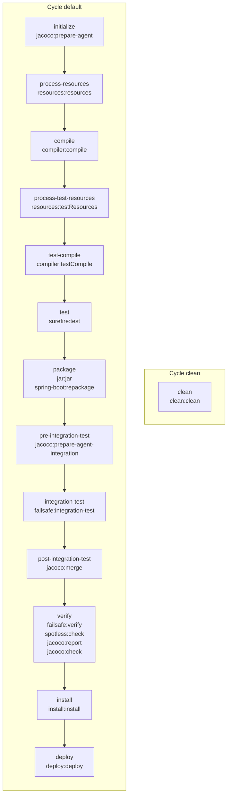
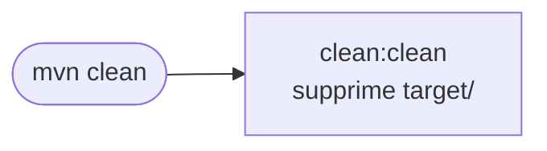
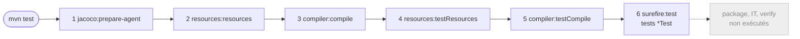
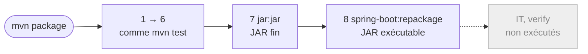
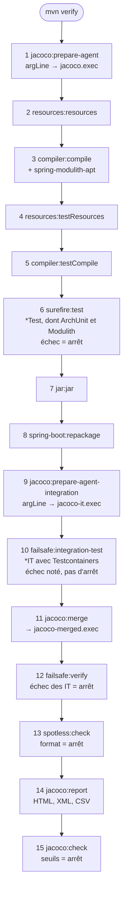
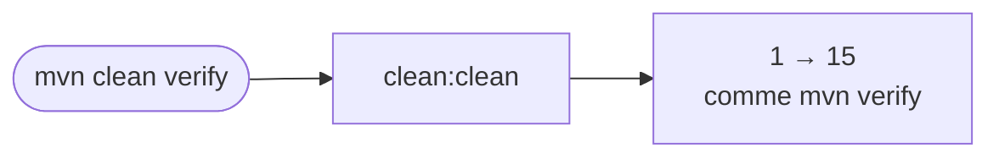
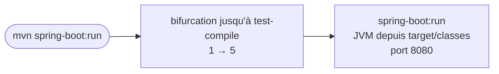

# Build Maven du backend : cycle de vie, plugins et sorties

Ce document décrit ce que fait Maven quand on lance `mvn verify` (ou une autre commande) dans `backend/` :
quels plugins interviennent, à quel moment du cycle de vie, ce qu'ils font et où ils écrivent leurs résultats.
Il s'adresse aux personnes qui maintiennent la CI ou diagnostiquent un build.

Les versions et les rattachements ci-dessous ont été relevés le 2026-10-21 sur `main` à partir du POM effectif
(`mvn help:effective-pom`), des descripteurs des plugins (`META-INF/maven/plugin.xml`) et du journal d'un
`mvn verify` réel. Ils changent avec le parent Spring Boot et les mises à jour Dependabot : voir
[Vérifier soi-même](#9-vérifier-soi-même).

## Sommaire

1. [Les concepts](#1-les-concepts)
2. [Les plugins du backend](#2-les-plugins-du-backend)
3. [Rattachement des goals aux phases](#3-rattachement-des-goals-aux-phases)
4. [Chemins d'exécution des commandes courantes](#4-chemins-dexécution-des-commandes-courantes)
5. [Où trouver les sorties](#5-où-trouver-les-sorties)
6. [Points d'attention](#6-points-dattention)
7. [Ce que fait la CI](#7-ce-que-fait-la-ci)
8. [Prérequis du poste](#8-prérequis-du-poste)
9. [Vérifier soi-même](#9-vérifier-soi-même)

---

## 1. Les concepts

### Cycle de vie (lifecycle)

Une suite **ordonnée** de phases. Maven en connaît trois, indépendants :

| Cycle de vie | Rôle | Phases principales |
|---|---|---|
| `clean` | Supprimer les résultats du build précédent | `pre-clean` → `clean` → `post-clean` |
| `default` | Construire, tester, empaqueter, publier | `validate` → … → `verify` → `install` → `deploy` |
| `site` | Générer un site de documentation du projet | `pre-site` → `site` → `post-site` → `site-deploy` |

Le cycle `default` complet (en gras, les phases où ce projet exécute réellement quelque chose) :

`validate` → **`initialize`** → `generate-sources` → `process-sources` → `generate-resources` →
**`process-resources`** → **`compile`** → `process-classes` → `generate-test-sources` → `process-test-sources` →
`generate-test-resources` → **`process-test-resources`** → **`test-compile`** → `process-test-classes` →
**`test`** → `prepare-package` → **`package`** → **`pre-integration-test`** → **`integration-test`** →
**`post-integration-test`** → **`verify`** → **`install`** → **`deploy`**

### Phase

Une étape du cycle de vie. **Une phase ne fait rien par elle-même** : elle n'est qu'un point de rendez-vous
auquel des goals sont rattachés. Une phase sans goal rattaché est traversée sans effet.

Demander une phase exécute **toutes les phases précédentes du même cycle de vie, puis celle-ci**. `mvn verify`
exécute donc `validate`, `initialize`, … jusqu'à `verify`, mais ni `install` ni `deploy`.

### Plugin et goal

Tout le travail réel est fait par des **plugins**. Un plugin expose un ou plusieurs **goals** (appelés aussi
*mojos*), chacun étant une tâche précise : `compiler:compile` compile `src/main/java`, `surefire:test` lance les
tests unitaires, `jacoco:report` produit le rapport de couverture.

Un goal s'écrit `préfixe:goal` (`jacoco:report`) ou avec les coordonnées complètes
(`org.jacoco:jacoco-maven-plugin:0.8.13:report`).

Un goal peut déclarer dans son descripteur une **phase par défaut** : s'il est rattaché sans préciser de phase,
c'est celle-ci qui est utilisée (par exemple `initialize` pour `jacoco:prepare-agent`).

### Rattachement (binding)

Le lien entre un goal et une phase. Il vient de deux sources :

- **Le packaging** : pour `<packaging>jar</packaging>` (valeur par défaut, celle du backend), Maven rattache
  d'office `resources:resources` à `process-resources`, `compiler:compile` à `compile`, `surefire:test` à `test`,
  `jar:jar` à `package`, `install:install` à `install`, etc. Ces rattachements n'apparaissent pas dans le
  `pom.xml`.
- **Le POM** (le nôtre ou un parent) : un bloc `<execution>` dans `<build><plugins>`.

### Exécution (execution)

Un bloc `<execution>` rattache un ou plusieurs goals d'un plugin à une phase, avec une configuration propre :

```xml
<execution>
  <id>merge</id>                      <!-- identifiant, unique dans le plugin -->
  <phase>post-integration-test</phase> <!-- facultatif : sinon, la phase par défaut du goal -->
  <goals><goal>merge</goal></goals>
  <configuration>…</configuration>    <!-- ne s'applique qu'à cette exécution -->
</execution>
```

- Un même plugin peut avoir plusieurs exécutions : JaCoCo en a cinq dans notre POM.
- Sans `<id>`, l'exécution s'appelle `default`. Les rattachements venant du packaging s'appellent
  `default-<goal>` (`default-compile`, `default-test`, `default-jar`…).
- Le journal Maven affiche l'identifiant entre parenthèses :
  `--- jacoco-maven-plugin:0.8.13:merge (merge) @ kadoo-backend ---`.

### Configuration : niveau plugin ou niveau exécution

- `<configuration>` **directement sous `<plugin>`** : s'applique à toutes les exécutions du plugin **et** aux
  appels directs en ligne de commande (c'est le cas de Spotless : `mvn spotless:apply` utilise le même format
  que la vérification du build).
- `<configuration>` **sous `<execution>`** : ne s'applique qu'à cette exécution. C'est le cas des seuils de
  `jacoco:check` : un `mvn jacoco:check` lancé à la main ne les connaît pas, sauf avec `jacoco:check@check`
  (voir plus bas).

### Ordre des goals dans une même phase

Quand plusieurs goals sont rattachés à la même phase, Maven les exécute dans cet ordre :

1. les rattachements du packaging ;
2. puis les plugins **dans leur ordre de déclaration dans le POM**, et pour un plugin, ses exécutions dans
   l'ordre de déclaration.

C'est ce qui explique l'ordre observé dans la phase `verify` : `failsafe:verify`, puis `spotless:check`, puis
`jacoco:report`, puis `jacoco:check`, conformément à l'ordre des plugins dans `backend/pom.xml`.

### Appeler une phase ou appeler un goal

| Commande | Effet |
|---|---|
| `mvn verify` | Phase : toutes les phases jusqu'à `verify`, avec tous leurs goals. |
| `mvn spotless:apply` | Goal seul : uniquement ce goal, **sans** cycle de vie (rien n'est compilé). |
| `mvn jacoco:check@check` | Goal seul avec la configuration de l'exécution `check` du POM (les seuils). |
| `mvn clean verify` | Deux demandes enchaînées : le cycle `clean`, puis le cycle `default` jusqu'à `verify`. |

### Cycle de vie bifurqué (forked lifecycle)

Certains goals demandent à Maven d'exécuter d'abord une partie du cycle de vie, dans une exécution parallèle
dite *bifurquée*. C'est le cas de `spring-boot:run` : son descripteur déclare `executePhase=test-compile`.
`mvn spring-boot:run` compile donc le code et les tests avant de démarrer l'application.

### Parent, pluginManagement et POM effectif

Notre POM hérite de `spring-boot-starter-parent` 4.0.2. Ce parent fixe les **versions** des plugins Maven
standard (`<pluginManagement>`) et une partie de leur configuration (par exemple `mainClass` pour le JAR,
`classesDirectory` pour Failsafe). C'est pourquoi le `pom.xml` déclare des plugins sans version.

Le **POM effectif** est le résultat de la fusion : packaging, super-POM de Maven, parent et notre POM.
C'est lui qui fait foi : `mvn help:effective-pom`.

### Propriétés partagées entre plugins

Les plugins communiquent parfois par des propriétés Maven. Ici, `jacoco:prepare-agent` écrit la propriété
`argLine` (l'option `-javaagent:` de JaCoCo), que Surefire et Failsafe ajoutent à la ligne de commande de la JVM
de test. C'est ce qui permet de mesurer la couverture sans rien configurer dans Surefire.

---

## 2. Les plugins du backend

| Plugin | Version | Déclaré par | Rôle dans le projet |
|---|---|---|---|
| `maven-clean-plugin` | 3.5.0 | packaging (version : parent) | Supprime `target/`. |
| `jacoco-maven-plugin` | 0.8.13 | `pom.xml` | Couverture de code : agent, fusion, rapport, seuils (NFR-042, NFR-050). |
| `maven-resources-plugin` | 3.3.1 | packaging | Copie `src/main/resources` et `src/test/resources` dans `target/`. |
| `maven-compiler-plugin` | 3.14.1 | packaging (`-parameters` : parent) | Compile Java 21 ; exécute les processeurs d'annotations. |
| `maven-surefire-plugin` | 3.5.4 | packaging | Lance les tests unitaires `*Test`. |
| `maven-jar-plugin` | 3.4.2 | packaging (manifeste : parent) | Construit le JAR « fin » (classes seules). |
| `spring-boot-maven-plugin` | 4.0.2 | `pom.xml` (exécution `repackage` : parent) | Transforme le JAR en JAR exécutable ; `spring-boot:run` pour le poste local. |
| `maven-failsafe-plugin` | 3.5.4 | `pom.xml` | Lance les tests d'intégration `*IT` (PostgreSQL réel via Testcontainers) et décide de l'échec. |
| `spotless-maven-plugin` | 2.44.5 | `pom.xml` | Vérifie le format du code (Palantir Java Format, imports inutilisés), NFR-042. |
| `maven-install-plugin` | 3.1.4 | packaging | Copie le JAR et le POM dans le dépôt local `~/.m2`. |
| `maven-deploy-plugin` | 3.1.4 | packaging | Publierait vers un dépôt distant ; **non configuré** (voir §6). |
| `maven-site-plugin` | 3.3 | super-POM | Cycle `site` ; **non utilisé**. |

### Détail par plugin

**JaCoCo** (5 exécutions déclarées dans `pom.xml`) :

| Exécution | Goal | Phase | Ce qu'il fait |
|---|---|---|---|
| `prepare-agent` | `prepare-agent` | `initialize` (défaut du goal) | Écrit `argLine` = agent JaCoCo → `target/jacoco.exec` (tests unitaires). |
| `prepare-agent-it` | `prepare-agent-integration` | `pre-integration-test` (défaut) | Réécrit `argLine` → `target/jacoco-it.exec` (tests d'intégration). |
| `merge` | `merge` | `post-integration-test` (forcée ; défaut `generate-resources`) | Fusionne les deux fichiers en `target/jacoco-merged.exec`. |
| `report` | `report` | `verify` | Rapport HTML, XML et CSV depuis le fichier fusionné. |
| `check` | `check` | `verify` | Fait échouer le build sous les seuils : 60 % de lignes au global, 80 % sur `shared.money`, `order`, `payment`, `issuance`, `redemption`. |

**Surefire** : tests dont le nom correspond aux motifs par défaut (`**/Test*.java`, `**/*Test.java`,
`**/*Tests.java`, `**/*TestCase.java`). Un test en échec arrête le build à la phase `test`.

**Failsafe** (2 goals) :

- `integration-test` (phase `integration-test`) : lance les classes `**/IT*.java`, `**/*IT.java`,
  `**/*ITCase.java`. **Il n'arrête pas le build en cas d'échec** : il écrit le résultat dans
  `failsafe-summary.xml`.
- `verify` (phase `verify`) : lit ce résumé et fait échouer le build si besoin.

Cette séparation laisse s'exécuter `post-integration-test` (ici : la fusion JaCoCo ; ailleurs, l'arrêt d'un
serveur) même quand un test d'intégration échoue. Le parent Spring Boot configure `classesDirectory` sur
`target/classes`, car le JAR réempaqueté par Spring Boot ne peut pas servir de classpath de test.

**Compiler** : en plus de la compilation, il exécute les processeurs d'annotations présents dans les
dépendances. `spring-modulith-apt` (apporté par `spring-modulith-starter-core`) produit ainsi
`target/generated-spring-modulith/javadoc.json`, utilisé par la documentation des modules.

**Spring Boot** :

- `repackage` (phase `package`) : remplace le JAR fin par un JAR exécutable (`java -jar`), avec les dépendances
  dans `BOOT-INF/lib`. Le JAR d'origine est conservé sous `*.jar.original`.
- `run` (appel direct) : bifurque jusqu'à `test-compile`, puis démarre l'application depuis `target/classes`.
  N'utilise pas `argLine` : pas d'agent JaCoCo (le journal affiche `Attaching agents: []`).

**Spotless** :

- `check` (phase `verify`) : échoue si un fichier n'est pas formaté. Un cache (`target/spotless-index`) évite de
  revérifier les fichiers inchangés.
- `apply` (appel direct uniquement, aucune phase par défaut) : reformate les fichiers. À lancer avant de
  commiter : `mvn spotless:apply`.

---

## 3. Rattachement des goals aux phases

Vue d'ensemble du cycle `default` du backend. Seules les phases qui exécutent un goal sont représentées.



Le même rattachement en tableau, dans l'ordre d'exécution :

| # | Phase | Goal (exécution) | Origine |
|---|---|---|---|
| 1 | `initialize` | `jacoco:prepare-agent` (`prepare-agent`) | `pom.xml` |
| 2 | `process-resources` | `resources:resources` (`default-resources`) | packaging |
| 3 | `compile` | `compiler:compile` (`default-compile`) | packaging |
| 4 | `process-test-resources` | `resources:testResources` (`default-testResources`) | packaging |
| 5 | `test-compile` | `compiler:testCompile` (`default-testCompile`) | packaging |
| 6 | `test` | `surefire:test` (`default-test`) | packaging |
| 7 | `package` | `jar:jar` (`default-jar`) | packaging |
| 8 | `package` | `spring-boot:repackage` (`repackage`) | parent Spring Boot |
| 9 | `pre-integration-test` | `jacoco:prepare-agent-integration` (`prepare-agent-it`) | `pom.xml` |
| 10 | `integration-test` | `failsafe:integration-test` (`default`) | `pom.xml` |
| 11 | `post-integration-test` | `jacoco:merge` (`merge`) | `pom.xml` |
| 12 | `verify` | `failsafe:verify` (`default`) | `pom.xml` |
| 13 | `verify` | `spotless:check` (`default`) | `pom.xml` |
| 14 | `verify` | `jacoco:report` (`report`) | `pom.xml` |
| 15 | `verify` | `jacoco:check` (`check`) | `pom.xml` |
| 16 | `install` | `install:install` (`default-install`) | packaging |
| 17 | `deploy` | `deploy:deploy` (`default-deploy`) | packaging |

---

## 4. Chemins d'exécution des commandes courantes

Chaque diagramme montre, **dans l'ordre chronologique**, les goals réellement exécutés. Les numéros renvoient
au tableau du §3. En gris, ce que la commande n'exécute pas.

### `mvn clean`

Cycle `clean` seul : supprime `target/`. Ne compile rien.



### `mvn test` (étapes 1 à 6)

Compile et lance les tests unitaires. Produit `target/jacoco.exec`, mais **aucun rapport de couverture** :
`jacoco:report` est rattaché à `verify`.



### `mvn package` (étapes 1 à 8)

Ajoute le JAR exécutable. Les tests unitaires tournent, **pas les tests d'intégration** ni les contrôles de
format et de couverture. `mvn package -DskipTests` saute aussi les tests unitaires.



### `mvn verify` (étapes 1 à 15) : la commande de référence

C'est la commande de la CI et celle à lancer avant une PR (`CLAUDE.md`). Elle exécute toutes les barrières de
qualité. Durée observée : environ 2 min 30 en local (démarrage des conteneurs Testcontainers compris).



### `mvn clean verify`

Le cycle `clean` (supprime `target/`) puis les étapes 1 à 15. À préférer en cas de doute sur un état
incrémental (fichiers `.exec` anciens, classes supprimées encore présentes dans `target/classes`).



### `mvn install` (étapes 1 à 16)

Tout `verify`, puis copie du JAR et du POM dans `~/.m2/repository/ma/kadoo/kadoo-backend/0.1.0-SNAPSHOT/`.
Inutile pour ce projet (aucun autre module Maven ne dépend du backend) ; `verify` suffit.


### `mvn spotless:apply`

Goal seul : aucun cycle de vie, rien n'est compilé ni testé. Reformate `src/**/*.java`.


### `mvn spring-boot:run -Dspring-boot.run.profiles=local`

Goal avec cycle de vie bifurqué jusqu'à `test-compile`, puis démarrage de l'application. Prérequis :
`docker compose up -d` (PostgreSQL).



### Comparaison des commandes

Lecture de haut en bas = ordre chronologique. ✓ = exécuté, — = non exécuté.

| # | Goal | `clean` | `test` | `package` | `verify` | `clean verify` | `install` | `spring-boot:run` | `spotless:apply` |
|---|---|---|---|---|---|---|---|---|---|
| – | `clean:clean` | ✓ | — | — | — | ✓ | — | — | — |
| 1 | `jacoco:prepare-agent` | — | ✓ | ✓ | ✓ | ✓ | ✓ | ✓ | — |
| 2 | `resources:resources` | — | ✓ | ✓ | ✓ | ✓ | ✓ | ✓ | — |
| 3 | `compiler:compile` | — | ✓ | ✓ | ✓ | ✓ | ✓ | ✓ | — |
| 4 | `resources:testResources` | — | ✓ | ✓ | ✓ | ✓ | ✓ | ✓ | — |
| 5 | `compiler:testCompile` | — | ✓ | ✓ | ✓ | ✓ | ✓ | ✓ | — |
| 6 | `surefire:test` | — | ✓ | ✓ | ✓ | ✓ | ✓ | — | — |
| 7 | `jar:jar` | — | — | ✓ | ✓ | ✓ | ✓ | — | — |
| 8 | `spring-boot:repackage` | — | — | ✓ | ✓ | ✓ | ✓ | — | — |
| 9 | `jacoco:prepare-agent-integration` | — | — | — | ✓ | ✓ | ✓ | — | — |
| 10 | `failsafe:integration-test` | — | — | — | ✓ | ✓ | ✓ | — | — |
| 11 | `jacoco:merge` | — | — | — | ✓ | ✓ | ✓ | — | — |
| 12 | `failsafe:verify` | — | — | — | ✓ | ✓ | ✓ | — | — |
| 13 | `spotless:check` | — | — | — | ✓ | ✓ | ✓ | — | — |
| 14 | `jacoco:report` | — | — | — | ✓ | ✓ | ✓ | — | — |
| 15 | `jacoco:check` | — | — | — | ✓ | ✓ | ✓ | — | — |
| 16 | `install:install` | — | — | — | — | — | ✓ | — | — |
| – | `spring-boot:run` | — | — | — | — | — | — | ✓ (après 5) | — |
| – | `spotless:apply` | — | — | — | — | — | — | — | ✓ |

---

## 5. Où trouver les sorties

Tout est sous `backend/target/` (supprimé par `mvn clean`).

| Chemin | Produit par | Contenu |
|---|---|---|
| `classes/` | `resources:resources`, `compiler:compile` | Classes compilées et ressources (`application.yml`, migrations Flyway). |
| `test-classes/` | `resources:testResources`, `compiler:testCompile` | Classes et ressources de test. |
| `generated-sources/annotations/` | `compiler:compile` | Sources générées par les processeurs d'annotations. |
| `generated-test-sources/` | `compiler:testCompile` | Idem pour les tests. |
| `generated-spring-modulith/javadoc.json` | `compiler:compile` (spring-modulith-apt) | Javadoc des modules pour la documentation Spring Modulith. |
| `maven-status/` | `compiler` | État de la compilation incrémentale (listes de fichiers). |
| `jacoco.exec` | agent JaCoCo pendant `surefire:test` | Données binaires de couverture des tests unitaires. |
| `surefire-reports/` | `surefire:test` | Un `TEST-<classe>.xml` (format JUnit, lu par la CI) et un `.txt` par classe ; fichiers `*.dump` en cas de problème de JVM de test. |
| `kadoo-backend-0.1.0-SNAPSHOT.jar` | `jar:jar` puis `spring-boot:repackage` | **JAR exécutable** (`java -jar`). |
| `kadoo-backend-0.1.0-SNAPSHOT.jar.original` | `spring-boot:repackage` | Le JAR fin d'origine, avant réempaquetage. |
| `maven-archiver/pom.properties` | `jar:jar` | `groupId`, `artifactId`, `version` du JAR. |
| `jacoco-it.exec` | agent JaCoCo pendant `failsafe:integration-test` | Couverture des tests d'intégration. |
| `failsafe-reports/` | `failsafe:integration-test` | `TEST-<classe>.xml` par classe d'IT et `failsafe-summary.xml` (lu par `failsafe:verify`). |
| `jacoco-merged.exec` | `jacoco:merge` | Couverture fusionnée (unitaires + intégration) : base du rapport et des seuils. |
| `site/jacoco/index.html` | `jacoco:report` | **Rapport de couverture HTML** (à ouvrir dans un navigateur). |
| `site/jacoco/jacoco.xml`, `jacoco.csv` | `jacoco:report` | Mêmes données pour les outils (Sonar, scripts). |
| `spotless-index` | `spotless:check` / `apply` | Cache des fichiers déjà vérifiés. |

Hors de `target/` :

| Chemin | Produit par | Contenu |
|---|---|---|
| `~/.m2/repository/` | Maven (résolution) | Plugins et dépendances téléchargés ; mis en cache par la CI (`setup-java`, `cache: maven`). |
| `~/.m2/repository/ma/kadoo/kadoo-backend/` | `install:install` | JAR et POM installés (seulement après `mvn install`). |
| `src/**/*.java` | `spotless:apply` | Fichiers reformatés sur place. |

---

## 6. Points d'attention

- **Un test d'intégration en échec ne s'arrête pas tout de suite.** `failsafe:integration-test` note l'échec,
  `jacoco:merge` s'exécute, puis `failsafe:verify` arrête le build. Le message d'échec apparaît donc après
  la fusion JaCoCo dans le journal. Lire `target/failsafe-reports/` pour le détail.
- **`jacoco:check` ne lit que le fichier fusionné.** Si `jacoco-merged.exec` est absent ou ancien (build
  partiel, `-DskipITs`), le ratio de couverture devient faux. En cas de doute : `mvn clean verify`.
- **`argLine` est réécrit** par `prepare-agent-integration`. Toute option de JVM de test ajoutée à la main
  dans Surefire ou Failsafe doit inclure `@{argLine}`, sinon l'agent JaCoCo disparaît et la couverture tombe.
- **`mvn package` ne vérifie ni le format, ni la couverture, ni les tests d'intégration.** Un JAR produit par
  `package` n'a pas passé les barrières de qualité : seul `verify` les exécute.
- **`deploy` n'est pas configuré** (pas de `<distributionManagement>`) : `mvn deploy` échouerait. La livraison
  passe par la CI, pas par la publication d'un JAR dans un dépôt Maven.
- **Options utiles** : `-DskipTests` (saute Surefire et Failsafe), `-DskipITs` (saute Failsafe seulement),
  `-Dtest=LoginIT` (Surefire) ou `-Dit.test=LoginIT` (Failsafe) pour cibler une classe, `-o` (hors ligne),
  `-B -ntp` (mode non interactif, sans barre de téléchargement : ce qu'utilise la CI). Sauter des tests ne
  doit servir qu'au diagnostic local, jamais à faire passer la CI (`CLAUDE.md`, « Interdits »).
- **`-q` masque aussi la sortie des goals d'information** comme `help:describe` : ne pas le combiner avec eux.

---

## 7. Ce que fait la CI

`.github/workflows/backend.yml` :

1. `actions/setup-java` : Temurin 21, cache du dépôt `~/.m2`.
2. `mvn -B -ntp verify` : étapes 1 à 15 ci-dessus. Les tests d'intégration utilisent Testcontainers, avec le
   Docker du runner GitHub.
3. Publication de `backend/target/site/jacoco` comme artefact `jacoco-report`, même en cas d'échec
   (`if: always()`).

---

## 8. Prérequis du poste

- **Java 21** (Spring Boot 4, Spotless). Si le shell pointe sur un autre JDK :
  `export JAVA_HOME=/usr/lib/jvm/java-21-openjdk-amd64`.
- Une variable `MAVEN_OPTS` qui contient des options de JVM retirées de Java 21 (par exemple
  `-XX:+UseConcMarkSweepGC`) empêche Maven de démarrer ; la redéfinir, par exemple
  `MAVEN_OPTS="-Xmx3072m -Xms256m"`.
- **Docker** démarré : Testcontainers en a besoin pour les `*IT`.
- Voir aussi `docs/dev/environnement-dev.md`.

---

## 9. Vérifier soi-même

Ces commandes, lancées dans `backend/`, permettent de retrouver chaque information de ce document, par exemple
après une montée de version du parent Spring Boot :

```bash
# POM effectif : versions, exécutions et phases de tous les plugins après héritage
mvn help:effective-pom -Doutput=target/effective-pom.xml

# Phase par défaut d'un goal, et cycle de vie qu'il bifurque éventuellement
mvn help:describe -Dplugin=org.springframework.boot:spring-boot-maven-plugin -Dgoal=run -Ddetail

# Ordre réel des goals : chaque ligne « --- plugin:version:goal (exécution) @ kadoo-backend --- »
mvn verify | grep -- '--- '
```
